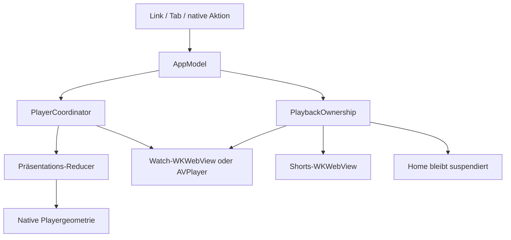

# Architektur

Weiktube iOS ist als native Swift-/SwiftUI-App für iOS und iPadOS 17 aufgebaut. Die originale YouTube-Website läuft in behaltenen WKWebViews. Native Ansichten übernehmen App-Navigation, Einstellungen, Kontoaktionen, Verlauf, Filtersteuerung und zusätzliche Playerbedienung. Öffentliche direkte HTTPS-Medien besitzen einen getrennten AVPlayer-Pfad. YouTube-Medien-URLs werden nicht für AVPlayer extrahiert.

Dieser Text beschreibt den vorhandenen Quellcode und seine Verantwortlichkeiten. Er behauptet keinen erfolgreichen vollständigen Apple-SDK-Build. Die tatsächlich ausgeführten Tests und ihre Reichweite stehen in [TESTING.md](../TESTING.md); offene Funktionsabweichungen in [FEATURE-PARITY.md](FEATURE-PARITY.md).

## Module und Verantwortlichkeiten

| Bereich | Verantwortung | Zentrale Dateien |
| --- | --- | --- |
| App | Dauerhafte Dienste/Views, Tabs, externe Eingänge, Szenenphase, native Sheets | `Weiktube/App/AppModel.swift`, `RootView.swift`, `WeiktubeApp.swift` |
| Navigation | Strikte kanonische YouTube-/Shorts-/Browse-/Direktmedienrouten | `Weiktube/Navigation/YouTubeLinkRouter.swift` |
| WebKit | Konfiguration, gemeinsame Website-Daten, Navigation, Suspendierung, Bridge-Validierung | `Weiktube/WebKit/WebSession.swift`, `WebSurface.swift`, `MediaSnapshot.swift` |
| Player | Quellwahl, Wiedergabeabsicht, Position, Enhancement-Lebensdauer, Präsentation | `Weiktube/Player/PlayerCoordinator.swift`, `PlaybackOwnership.swift`, `PlayerPanel.swift`, `PlaybackSurface.swift` |
| Core | Deterministischer Präsentationszustand und Übergänge | `Weiktube/Core/PlayerPresentationState.swift` |
| Direktmedien | AVPlayer, AVPlayerLayer, PiP, Rate, Seek und unterstützte Untertitel | `Weiktube/Player/NativePlayback.swift` |
| Shorts | Originalfeed plus native zugängliche Timeline-/Audioaktionen | `Weiktube/Shorts/ShortsScreen.swift`, `Weiktube/Player/SeekTimeline.swift` |
| Account/Networking | System-OAuth, Keychain, Data API, Modelle, begrenzte öffentliche Bilder | `Weiktube/Account/`, `Weiktube/Networking/` |
| Schutz | WKContentRuleList, signierte Datenupdates, geprüfte Scriptlets und lokale Testfläche | `Weiktube/AdBlock/`, `Weiktube/Resources/Filters/` |
| Community | Optionale SponsorBlock-Segmente und RYD-Schätzungen | `Weiktube/SponsorBlock/`, `Weiktube/ReturnYouTubeDislike/` |
| Persistenz | Atomische Dateien, Verlauf, gemeinsame Link-Inbox und Wiederherstellungsdaten | `Weiktube/Persistence/`, `Weiktube/History/` |
| Einstellungen/Diagnose | Lokale Präferenzen, feste Ereignisse, explizit teilbarer Bericht | `Weiktube/Settings/`, `Weiktube/Diagnostics/` |
| iOS-Einstiege | Share Extension, App Group, Custom Scheme und App Intents | `ShareExtension/`, `Weiktube/AppIntents/`, Plists/Entitlements |

## Eine Präsentation, mehrere behaltene Oberflächen

`AppModel` hält Home, Shorts und Watch als getrennte langlebige WebSession-Instanzen. Der erste Shorts-Netzabruf erfolgt erst bei Nutzung. SwiftUI darf die sichtbare Repräsentation wechseln, ohne daraus einen neuen YouTube-Player zu erzeugen. Der zusätzliche Schutzbrowser ist eine separate Hilfsansicht und bleibt medial suspendiert.

`PlayerPresentationState` ist die einzige Autorität für `closed`, `expanded`, `mini`, `fullscreen` und `pictureInPicture`. Sein Reducer beginnt keine Wiedergabe und erzeugt keine WebViews. Er verarbeitet Quellwahl, manuelles Vollbild, Lageänderung und bestätigte PiP-Ereignisse. Der Latch für manuelles Verlassen von Vollbild bleibt bis zum Wechsel zwischen aufrechter und seitlicher Haltung bestehen. Unbekannte und kopfstehende Ausrichtungen ändern die Präsentation nicht.

Bei YouTube zeigt ein neu geöffnetes Video standardmäßig das Originaldokument mit dessen Steuerung, Metadaten und Empfehlungen. Mini verändert den logischen Website-Viewport nicht: Der native Host behält seine expandierten Abmessungen und wird um das gemeldete sichtbare Videorechteck skaliert und beschnitten. Die Mini-Aktionen liegen als native Controls darüber. Vollbild isoliert den Videobereich; beim Rückweg werden zuvor gesicherte DOM-Stile in umgekehrter Reihenfolge restauriert. Eine reine Darstellungsänderung lädt kein neues Video.

Die 180-ms-Animation und Reduce-Motion-Alternative sind Quellcode. Eine mathematisch korrekte Rechteckrechnung ersetzt keine Videoaufnahme eines flüssigen Übergangs auf einem iPhone. Insbesondere Safe Areas, WebKit-Zoom, Letterbox, 4:3-/9:16-Medien und iPad-Fenstergrößen müssen praktisch geprüft werden.

## Genau ein hörbarer Besitzer

`PlaybackOwnership` führt Besitzerwechsel seriell aus. Es wartet auf einen vorher begonnenen Übergang, suspendiert konkurrierende WebViews und gibt erst danach den gewünschten Besitzer frei. Eine monoton steigende Revision verhindert, dass ein älterer asynchroner Auftrag anschließend einen veralteten Besitzer freigibt.

Eine neue Watch-/Direktmedienauswahl wartet vor dem Öffnen auf die Entziehung des bisherigen Besitzes. AVPlayer bereitet einen neuen Eintrag pausiert vor. Bewusstes Play wird erst nach abgeschlossenem Besitzwechsel ausgeführt. Ein Play-Tipp auf den Mini verlässt gegebenenfalls den Shorts-Tab, damit eine verdeckte Watch-Fläche nicht an der Besitzentscheidung vorbeispielt.

WebKit erhält zusätzlich `setAllMediaPlaybackSuspended`. Die JavaScript-Bridge pausiert andere Videoelemente innerhalb desselben Dokuments. Native Suspendierung ist dabei die stärkere Grenze: Eine Website kann nicht durch einen erneuten eigenen `play()`-Aufruf eine inaktive WebView zur Audioquelle machen. Home-Vorschauen und der Hilfsbrowser werden nicht hörbare Besitzer.

Szenenphase, explizite Pause und bestätigtes PiP werden getrennt behandelt. Sichtbarkeit allein gilt nicht als Nutzerwunsch zum Start. Bei Shorts wird nach Suspendierung nur die zuvor laufende Wiedergabe einmalig wieder versucht; eine bewusst pausierte Wiedergabe bleibt pausiert. Autoplay-Ablehnung führt zu einer sichtbaren Nutzeraktion und keiner unbegrenzten Play-/Unmute-Schleife.

## Identität und asynchrone Grenzen

Mehrere unabhängige Revisionsgrenzen sind erforderlich, weil ein gültiger WebView-Verweis noch kein gültiges aktuelles Video beweist.

| Grenze | Identität / Prüfung | Verhindertes Problem |
| --- | --- | --- |
| Externe Auswahl | `AppModel.routeRevision` und Abbruch vorheriger Route-Task | Älterer Import öffnet nach neuer Nutzerwahl ein falsches Video. |
| Playerquelle | Coordinator-Generation und aktuelle Route | Späte Sponsor-/Seek-/Resume-/Native-Antwort verändert neue Auswahl. |
| Webdokument | WebSession-Generation, frischer Token, Main-Frame und HTTPS-Origin | Nachricht eines alten Dokuments oder fremden Subframes wird angenommen. |
| Aktives DOM-Medium | Aktuelles Element, URL-Identität, Verbundenheit und sichtbare Auswahl | Vorgerendertes oder abgetrenntes Shorts-Video erhält Seek/Play. |
| Konto | Authorization-/Account-Revision und erwartete Sitzung pro Request | Daten oder Schreibabsicht des vorigen Kontos gelangen in das neue Konto. |
| Verlauf | History-Revision und Update ausschließlich vorhandener Items | Späte Metadaten erzeugen gelöschte Einträge erneut. |
| Filterkompilierung | Konfigurationsrevision und erfolgreich kompilierter Kandidat | Ein fehlgeschlagenes/älteres Update ersetzt den letzten guten Regelsatz. |

Die Medienbridge liegt in `WKContentWorld.defaultClient`. Sie verwendet öffentliche DOM-/HTMLMediaElement-Operationen und sendet begrenzte Zustandsdaten. Herkunft, Frame, Nachrichtentyp, Token und numerische Generation werden vor Auswertung geprüft. Google-Tokens, Cookies, Antwort-Bodies und extrahierte Stream-URLs gehören nicht zu diesem Protokoll.

Ein Seek-Erfolg ist nicht die Zuweisung von `currentTime`. Der JavaScript-Auftrag wartet auf `seeked`, prüft die tatsächliche Position mit 350-ms-Toleranz und verwirft Timeout, Identitäts-/Kontextwechsel und ungültige Bereiche. Der SponsorBlock-Controller zählt nur einen bestätigten Auftrag. Ein konzeptionell gültiger Skip-Vorschlag ohne Medienbestätigung ist kein eingesparter Zeitraum.

Die Node-Tests führen diese tatsächliche Bridge mit kontrolliertem DOM, Medienereignissen und Zeit aus. Sie können keine WebKit-Implementierungsbesonderheit oder geänderte Live-YouTube-Struktur beweisen.

## Konto und Website sind getrennte Sitzungen

`GoogleOAuthService` öffnet die Systemauthentifizierung und nutzt PKCE, einen zufälligen State, einen konfigurierten iOS-Client und eine geprüfte Callback-URI. Zugangsdaten liegen im Keychain-Pfad der App. Sie werden ausschließlich dem erlaubten Google-API-Transport zugeführt. Die tatsächliche Clientkonfiguration bleibt leer, bis reale registrierte Kennungen vorliegen.

Die Website verwendet unabhängig `WKWebsiteDataStore.default()`. Eine native API-Freigabe erzeugt keine angemeldete YouTube-Websitzung. Die App kopiert keine Safari-/Google-Cookies, injiziert kein OAuth-Token in WebKit und fragt kein Passwort mit einer eigenen Loginmaske ab. Google erklärt die Einschränkung eingebetteter OAuth-User-Agents in seiner [OAuth-Dokumentation](https://developers.google.com/identity/protocols/oauth2/native-app#disallowed_useragent); die aktuelle [iOS-API-Freigabeanleitung](https://developers.google.com/identity/sign-in/ios/api-access) beschreibt die gesonderte API-Autorisierung.

Readonly-Consent und zusätzliche Interaktionsfreigabe sind separate Nutzeraktionen. Eine abgelehnte Erweiterung erhält den bisherigen Lesegrant; eine neue erfolgreich übernommene Freigabe invalidiert vorherige Antworten und leert vorherige Kontolisten. Die Freigabe selbst führt keinen Like-, Kommentar-, Abo- oder Playlist-Schreibauftrag aus. GET darf nach initialem 401 einmal erneuert werden; mehrdeutige Schreibfehler werden nicht automatisch wiederholt.

Abos, Feed, Playlists, Kommentare und Replies beruhen auf offiziellen Data-API-Antworten. Native Kontoansichten erfinden keine Beispiel-Abos oder Erfolgsmeldungen. Ein privates Video in einer API-Playlist ist noch keine Berechtigung für das davon unabhängige Web-Playback.

## Filterpfad und Updatevertrauen

AdBlock hat drei getrennte Mechanismen:

1. `WebKitRuleCompiler` übersetzt geprüfte Daten in eine WKContentRuleList für geeignete Requests und kosmetische Regeln.
2. Gepinnte lokale AdGuard-Scriptlets entfernen ausgewählte bekannte Werbefelder aus JSON/fetch/XHR. Diese Scriptlets müssen im Page-World laufen, weil sie die APIs des jeweiligen Dokuments instrumentieren.
3. Die angepasste Runtime erkennt begrenzte bekannte Werbe-/Rendererzustände, zählt tatsächliche Veränderungen und behandelt erkannten Ad-Durchbruch. Sie extrahiert keine Medienstreams und meldet keine erfundenen Netzwerkblockzahlen.

Ein neuer WK-Regelsatz wird zuerst kompiliert. Erst ein erfolgreicher aktueller Kandidat ersetzt die bisherige aktive Liste. Scheitert Kompilierung oder Verifikation, bleibt die letzte gute Version verfügbar. Neue Document-Start-Scriptlets können bereits laufende Hooks nicht zuverlässig rückgängig machen: Die Oberfläche fordert nach solchen Änderungen ein bewusstes Neuladen an. Regeln werden nicht heimlich mitten in einer laufenden Wiedergabe als erfolgreich erneuert dargestellt.

Die konfigurierte Updatequelle ist der bereits existierende Android-Filterrelease `adblock-rules-v1` unter `weikiboy-tech/Weiktube`, mit dessen bereits vorhandenem öffentlichen RSA-Schlüssel. Nur exakte signierte Datenbytes werden akzeptiert, danach ein strenges Schema, begrenzte Größe und eine nicht rückläufige Version. Remoteupdates enthalten keine neue ausführbare JavaScript-Datei. Der separate öffentliche Transport begrenzt Hosts, Redirects, Antwortgröße und Zeit und teilt keine Kontozugangsdaten.

`VendorSource` enthält die nötigen gepinnten Quellarchive und den deterministischen Generator zur Lizenz-/Reproduzierbarkeit. Diese großen Quellen gehören zum Repository und nicht als Laufzeitarchiv ins App-Bundle. Details und Änderungsprovenienz stehen in `Weiktube/Resources/Filters/PROVENANCE.md`.

Der lokale Shields-Test nutzt WKURLSchemeHandler und synthetische Testregeln, Kontrollressource und kosmetisches Element. Das kann nach Ausführung den lokalen WK-Mechanismus prüfen, beweist aber keine Werbewirkung auf YouTube. Siehe [ADBLOCK-VALIDATION.md](ADBLOCK-VALIDATION.md) und Apples [WKContentRuleListStore](https://developer.apple.com/documentation/webkit/wkcontentruleliststore).

## SponsorBlock und RYD

Beide Dienste sind standardmäßig aus und besitzen eigene Einwilligung/Einstellungen. Ihre Clients sind Actors mit begrenzter persistenter TTL-/LRU-Ablage, Mindestabstand zwischen Requests, Abkühlphasen und auf die aktuelle Auswahl begrenzter Ergebnisübernahme. Transport, Cookies und OAuth sind voneinander getrennt.

SponsorBlock fragt einen vierstelligen SHA-256-Präfix ab und filtert die Bucket-Antwort lokal nach exakter Video-ID. Ein reiner Zustandstyp validiert Kategorien, Zeiten, Videodauer, Überschneidungen und den Auto-/Manuell-/Aus-Modus. Pausiertes, suchendes, noch nicht bereites, live oder als Werbung erkanntes Playback löst keinen automatischen Skip aus. Versuch, bestätigter Erfolg, Undo und Nutzer-Zurückspulen sind verschiedene Ereignisse. Statistik wird erst nach bestätigtem Seek geschrieben und beim Undo einmalig korrigiert.

RYD fragt nach Einwilligung die öffentliche volle Video-ID ab, prüft Identität und Integerwerte und hält fehlende Antworten als unbekannt. Eine bestätigte echte Null bleibt Null. Die Anzeige kennzeichnet die Zahl als Schätzung. Es gibt keine RYD-Abstimmung oder Weitergabe der nativen Kontofreigabe.

## Persistenz und Konfiguration

| Speicher | Inhalt | Trennung |
| --- | --- | --- |
| UserDefaults | Allgemeine Einstellungen, Filter-/Sponsor-/RYD-Präferenzen, lokale Statistiken und Zeitgrenzen | Keine Google-Tokens. Services besitzen ihre eigenen Einstellungen. |
| Application Support / atomische JSON-Dateien | Verlauf und Player-Wiederherstellungsdaten | Begrenzte validierte Einträge; Löschrevision schützt vor alten Saves. |
| App Group | Validierte Link-Inbox zwischen Extension/Intent und Hauptapp | Keine Kontotokens oder Website-Cookies. Dateisperre verhindert verlorene parallele Zustellungen. |
| Caches | Begrenzte öffentliche Dienste-/Filterdaten | Signatur/Schema vor Filterübernahme; Communitydaten haben TTL. |
| Keychain | Native OAuth-Credentials | Nicht von WebKit oder Communitydiensten gelesen. |
| WKWebsiteDataStore | Website-Cookies und eigener Websitespeicher | Separat von lokalem Verlauf und nativer Freigabe löschbar. |

`Config/Local.example.xcconfig` nennt die erforderlichen echten lokalen Kennungen. `Config/Local.xcconfig` ist ignoriert. Es gibt keinen mitgelieferten Client-Secret, Apple-Signaturschlüssel oder erfundenen Team-Identifier. Share Extension und Host müssen dieselbe tatsächlich registrierte App Group verwenden. Build- und Installationsschritte stehen in [BUILD.md](../BUILD.md) und [INSTALLATION.md](../INSTALLATION.md).

## Prüfung und Änderungsregel

Der portable Swift-Testtarget umfasst nur die in `Package.swift` explizit genannten Foundation-Dateien. Konto, Keychain, SwiftUI, UIKit, AVFoundation und WebKit sind dadurch nicht kompiliert. Zusätzliche XCTest-/UI-Testquellen benötigen Xcode. Erfolgreiches `-frontend -parse` sagt nur, dass der Swift-Parser die Syntax akzeptiert.

Eine Änderung an Ownership, Dokumentgeneration oder PiP muss alte Antworten und schnelle Quellwechsel mitdenken. Eine Änderung an Mini muss das bestehende Dokument und seinen logischen Viewport erhalten. Eine Änderung an Filterschema/-Scriptlets muss Gegenfälle für Medien-/Auth-Daten, Ausnahme/aus, Signatur, Manipulation und Quellreproduzierbarkeit enthalten. Umfang und Evidenz werden anschließend in [FEATURE-PARITY.md](FEATURE-PARITY.md) aktualisiert.
